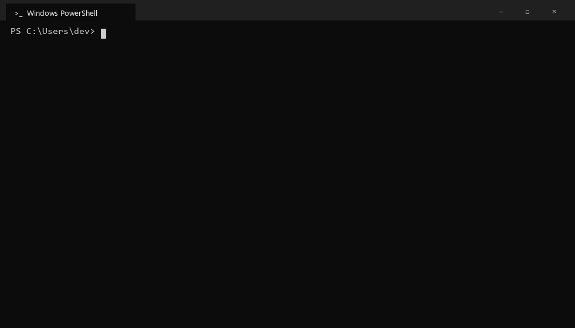

# wsl-docker-engine

**Docker en Windows sin Docker Desktop.** Usa `docker` y `docker compose` desde cmd, PowerShell o cualquier terminal, igual que con Docker Desktop, pero sin interfaz gráfica, sin restricciones de licencia y mucho más ligero.



Instala el **Docker Engine** open source dentro de WSL 2, el **CLI oficial de Docker** para Windows y un pequeño relay que expone el motor en `\\.\pipe\docker_engine`, la misma conexión que usa Docker Desktop. Todo lo que funciona con Docker Desktop (el CLI `docker`, compose, buildx, VS Code, Testcontainers, SDKs) funciona sin configurar nada extra.

[English](README.md)

---

## Instalación

**Opción 1: un comando.** Abre PowerShell (no hace falta administrador) y pega:

```powershell
irm https://raw.githubusercontent.com/alozdev/wsl-docker-engine/main/install.ps1 | iex
```

**Opción 2: doble clic.** [Descarga el ZIP](https://github.com/alozdev/wsl-docker-engine/archive/refs/heads/main.zip), descomprímelo y haz doble clic en **`install.cmd`**.

Después abre una terminal **nueva**:

```
docker run --rm hello-world
```

La primera vez tarda unos minutos, porque descarga Ubuntu y Docker. El instalador se encarga de todo:

- **Si no tienes WSL**, lo instala. Windows pide permiso de administrador **una sola vez**. Si hace falta reiniciar, el instalador **continúa solo** cuando vuelves a iniciar sesión.
- **Distribución:** crea una distribución de WSL llamada `docker` (Ubuntu 24.04) e instala Docker Engine con el script oficial. Arranca solo con systemd.
- **Herramientas de Windows:** instala `docker.exe`, `docker compose` y `docker buildx` desde sus fuentes oficiales. Compose y buildx se comparan contra los checksums publicados.
- **Inicio de sesión:** Docker arranca automáticamente al iniciar sesión en Windows.
- **Verificación:** al final prueba que todo funcione de punta a punta.

### ¿Ya tienes algo instalado?

Ejecuta el instalador de todas formas. Se puede ejecutar varias veces sin problema y solo agrega lo que falta:

| Si ya tienes... | El instalador... |
|---|---|
| WSL | Lo usa. Si es anterior a 2.4.4, ejecuta `wsl --update`. |
| Una distribución con el mismo nombre | La reutiliza. Si ya tiene Docker Engine, lo conserva. |
| Tu propio `/etc/wsl.conf` | Respeta tu configuración y solo agrega lo necesario. Guarda un respaldo como `wsl.conf.before-wsl-docker-engine`. |
| CLI de Docker, compose o buildx | Los actualiza a la última versión y omite los que ya están al día. |
| Docker Desktop | Se detiene y te explica por qué: los dos usarían el mismo pipe. Desinstala Docker Desktop primero, o usa `-Force`. |
| Podman o Rancher Desktop usando `\\.\pipe\docker_engine` | Te pide detenerlo primero. |
| `DOCKER_HOST` configurado u otro `docker.exe` antes en el PATH | Te avisa, porque tendrían prioridad. |

## Requisitos

- Windows 10 2004+ o Windows 11, x64. **Funciona en Windows Home.**
- Virtualización activada en la BIOS/UEFI. Viene activada en la mayoría de las PCs.
- Internet durante la instalación.

## Cómo funciona

```
 Windows                                         Distribución WSL 2 "docker" (Ubuntu)
 ───────                                         ────────────────────────────────────
 docker.exe / compose / buildx / VS Code ...
        │
        ▼
 \\.\pipe\docker_engine  ◄── docker-pipe-relay.exe ── wsl.exe ── socat ──► /var/run/docker.sock
   (el mismo pipe que Docker Desktop)                                         │
                                                                    Docker Engine (systemd)
```

Docker Desktop hace lo mismo por dentro: una máquina Linux en WSL corre `dockerd`, y un proceso de Windows conecta el pipe con ella. Este proyecto reemplaza esa aplicación gráfica por:

- **`wsl/setup.sh`:** configura la distribución. Activa systemd, instala Docker Engine y socat, configura las actualizaciones de seguridad automáticas y mapea las unidades de Windows para compose.
- **`relay/docker-pipe-relay.cs`:** un relay de ~250 líneas que se compila en tu PC con el compilador de C# que ya trae Windows. No se descargan binarios precompilados de este repo.
- **`install.ps1` / `uninstall.ps1`:** la parte de Windows.

## Uso diario

| | |
|---|---|
| Encender | Automático al iniciar sesión. Cualquier comando `docker` también lo despierta. |
| Apagar (libera RAM) | `wsl --terminate docker` |
| Actualizar | Ejecuta el instalador otra vez. Además, Docker Engine en WSL recibe actualizaciones de seguridad automáticas. |
| Terminal dentro del motor | `wsl -d docker` |
| Desinstalar | `%LOCALAPPDATA%\Programs\wsl-docker-engine\installer\uninstall.cmd` |

El desinstalador **conserva** la distribución (tus contenedores, imágenes y volúmenes), salvo que uses `uninstall.ps1 -RemoveDistro`.

Los contenedores con `restart: unless-stopped` o `restart: always` vuelven a arrancar solos cuando Docker inicia al iniciar sesión.

## Bueno saber

- **Los bind mounts de compose funcionan** (`./data:/data`, `../volume:/var/lib/...`). El instalador configura `COMPOSE_CONVERT_WINDOWS_PATHS=1`, así compose convierte `C:\...` en `/c/...`, y `/c` apunta a tu disco C dentro de WSL.
- **Con `docker run -v`**, escribe las rutas de Windows como `/c/Users/tu-usuario/proyecto:/app` en vez de `C:\Users\...`.
- **Los puertos publicados solo son accesibles desde tu PC** (`localhost:5432`, etc.). Es más seguro que Docker Desktop, que los publica en todas las interfaces. Para exponer un puerto a tu red local, usa un port proxy de WSL o el [modo de red mirrored](https://learn.microsoft.com/windows/wsl/networking).
- **Rendimiento:** los **volúmenes con nombre** viven dentro de WSL y son rápidos. Montar carpetas de Windows funciona, pero el disco es más lento, igual que en Docker Desktop. Para bases de datos, mejor usa volúmenes con nombre.
- **Permisos en discos de Windows:** se activa la opción `metadata` de WSL, así las imágenes que necesitan dueño y permisos de Linux (como Postgres) funcionan con carpetas de Windows montadas.

## Seguridad

- **El pipe es solo para ti:** solo tu usuario de Windows puede conectarse, y se rechazan las conexiones remotas (`PIPE_REJECT_REMOTE_CLIENTS` más una regla explícita que niega a NETWORK).
- **Sin impostores:** si otro programa ya tiene `\\.\pipe\docker_engine`, el relay se niega a arrancar en vez de compartirlo.
- **Sin puerto TCP:** Docker nunca queda expuesto en un puerto TCP abierto (nada de `tcp://...:2375`).
- **Descargas verificadas:** compose y buildx se comparan con los checksums de su release. Docker Engine viene del repositorio apt oficial de Docker, y el CLI de `download.docker.com` por HTTPS.
- **Actualizaciones automáticas:** las de seguridad de Ubuntu y las de Docker Engine se instalan solas con `unattended-upgrades`.

Nota: quien puede usar `docker` tiene, en la práctica, acceso root dentro de la distribución de WSL. Es igual que con Docker Desktop.

## Solución de problemas

| Problema | Solución |
|---|---|
| `docker` no se reconoce | Abre una terminal **nueva** (el PATH cambió). |
| `failed to connect to the docker API at npipe:////./pipe/docker_engine` | Ejecuta `%LOCALAPPDATA%\Programs\wsl-docker-engine\bin\docker-pipe-relay.exe`, o cierra sesión y vuelve a entrar. Revisa `docker-pipe-relay.log` en esa carpeta. |
| La instalación falla con `0x80370102` | Activa la virtualización (Intel VT-x / AMD-V) en la BIOS/UEFI. |
| Docker no arranca dentro de WSL | `wsl -d docker -u root -- systemctl status docker` |
| Quiero otro nombre de distribución | `.\install.ps1 -Distro midocker` |
| No quiero que arranque solo | `.\install.ps1 -NoStartup` |

## Preguntas frecuentes

**¿Por qué no usar Docker Desktop?**
Es muy bueno, pero requiere suscripción de pago en empresas grandes, corre una interfaz y servicios pesados, y hay quien simplemente no lo quiere. Esto da la misma experiencia en la terminal usando solo piezas open source.

**¿Por qué no Podman?**
Podman también es buena opción. Este proyecto es para quien quiere el Docker Engine real (comportamiento 100% Docker, BuildKit, compose) con el CLI oficial.

**¿Por qué no usar `DOCKER_HOST=tcp://localhost:2375`?**
Eso abre un puerto sin autenticación con acceso root. Además, el reenvío de localhost de WSL corta los streams que usa `docker run` para mostrar la salida, así que no verías la salida de tus contenedores. El named pipe evita ambos problemas.

## Licencias

Los scripts y el relay de este proyecto usan la [licencia MIT](LICENSE).

El instalador **descarga** estos componentes desde sus fuentes oficiales; no los redistribuye:

| Componente | Licencia | Fuente |
|---|---|---|
| Docker Engine (Moby) | Apache-2.0 | `download.docker.com` (apt) |
| Docker CLI | Apache-2.0 | `download.docker.com` |
| Docker Compose | Apache-2.0 | `github.com/docker/compose` |
| Docker Buildx | Apache-2.0 | `github.com/docker/buildx` |
| socat | GPL-2.0 | Repositorio de Ubuntu |
| Ubuntu | Varias licencias open source | Microsoft Store / Canonical |

*Docker y el logo de Docker son marcas registradas de Docker, Inc. Este proyecto no está afiliado, respaldado ni patrocinado por Docker, Inc. No usa ni modifica Docker Desktop.*
