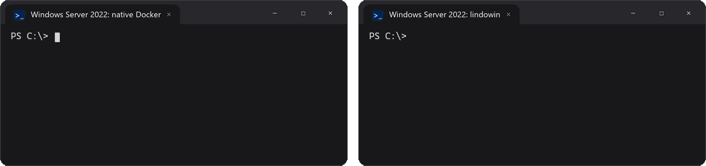

# lindowin

**Docker de Linux para Windows, sin interfaz.** Solo terminal. Sin GUI. Un comando.

`docker run nginx` funciona tal cual, en Windows 10/11 y en Windows Server, incluso Server Core.


[English](README.md)

## Por qué lindowin

- 🐧 **Contenedores Linux de verdad.** `nginx`, `postgres`, `redis`... cualquier imagen de Docker Hub. Incluso en Windows Server, donde el Docker nativo solo corre contenedores Windows.
- 💸 **Gratis para empresas.** Docker Desktop exige suscripción de pago a empresas de más de 250 empleados o más de 10 millones de dólares de ingresos. Aquí todo es open source.
- 🪶 **Sin interfaz.** Sin app en la bandeja ni ventanas en segundo plano. Menos de 1 GB de RAM en reposo, y cabe en Server Core.
- 🌐 **Puertos como en Linux.** `80:80` se alcanza desde tu red y `127.0.0.1:80:80` solo desde tu PC. TCP y UDP.
- 🔌 **Funciona con tus herramientas.** Usa el mismo `\.\pipe\docker_engine` que Docker Desktop, así que el CLI de `docker`, compose, buildx, VS Code, Testcontainers y los SDK funcionan sin configurar nada.
- 🔁 **Arranca solo.** Al iniciar sesión en una PC, y al encender en un servidor (sin iniciar sesión).

## Comparación

| | lindowin | Docker Desktop | Docker nativo en Windows Server |
|---|:---:|:---:|:---:|
| Imágenes Linux (`nginx`, `postgres`...) | ✅ | ✅ | ❌ solo imágenes Windows |
| Gratis para empresas | ✅ | ❌ de pago desde 250 personas / 10 M USD | ✅ |
| Windows Server / Server Core | ✅ | ❌ no soportado | ✅ |
| Sin interfaz, arranca sin iniciar sesión | ✅ | ❌ | ✅ |
| CLI oficial de `docker`, compose, buildx | ✅ | ✅ | ✅ |



Por dentro instala el **Docker Engine** open source dentro de WSL 2, el **CLI oficial de Docker** para Windows y un pequeño relay entre los dos. [Cómo funciona](#cómo-funciona).

---

## Instalación

**Opción 1: un comando.** Abre PowerShell (no hace falta administrador) y pega:

```powershell
irm https://raw.githubusercontent.com/alozdev/lindowin/main/install.ps1 | iex
```

**Opción 2: doble clic.** [Descarga el ZIP](https://github.com/alozdev/lindowin/archive/refs/heads/main.zip), descomprímelo y haz doble clic en **`install.cmd`**.

Después abre una terminal **nueva**:

```
docker run -d -p 8080:80 nginx
```

Luego abre http://localhost:8080 en tu navegador.

La primera vez tarda unos minutos, porque descarga Ubuntu y Docker. El instalador se encarga de todo:

- **Si no tienes WSL**, lo instala. Si hace falta reiniciar, el instalador **continúa solo** cuando vuelves a iniciar sesión.
- **Distribución:** crea una distribución de WSL llamada `docker` (Ubuntu 24.04) e instala Docker Engine con el script oficial. Arranca solo con systemd.
- **Herramientas de Windows:** instala `docker.exe`, `docker compose` y `docker buildx` desde sus fuentes oficiales. Compose y buildx se comparan contra los checksums publicados.
- **Puertos:** los puertos publicados funcionan [como en Linux](#puertos-publicados): `80:80` se alcanza desde tu red y `127.0.0.1:80:80` solo desde tu PC.
- **Arranque:** Docker arranca al iniciar sesión en Windows (en [Windows Server](#windows-server), al encender).
- **Verificación:** al final prueba que todo funcione de punta a punta.

Windows pide **permiso de administrador una sola vez**, para crear el grupo `docker-users`, la tarea de arranque y el servicio que abre los puertos publicados. Si dices que no, Docker funciona igual, pero solo desde tu PC y sin arranque automático.

### ¿Ya tienes algo instalado?

Ejecuta el instalador de todas formas. Se puede ejecutar varias veces sin problema y solo agrega lo que falta:

| Si ya tienes... | El instalador... |
|---|---|
| WSL | Lo usa. Si es anterior a 2.4.4, ejecuta `wsl --update`. |
| Una distribución con el mismo nombre | La reutiliza. Si ya tiene Docker Engine, lo conserva. |
| Tu propio `/etc/wsl.conf` | Respeta tu configuración y solo agrega lo necesario. Guarda un respaldo como `wsl.conf.before-wsl-docker-engine`. |
| CLI de Docker, compose o buildx | Los actualiza a la última versión y omite los que ya están al día. |
| Docker Desktop | Se detiene y te explica por qué: los dos usarían el mismo pipe. Desinstala Docker Desktop primero, o usa `-Force`. |
| Podman o Rancher Desktop usando `\\.\pipe\docker_engine` | Te pide detenerlo primero. |
| `DOCKER_HOST` configurado u otro `docker.exe` antes en el PATH | Te avisa, porque tendrían prioridad. |

## Requisitos

- Windows 10 2004+ o Windows 11, x64. **Funciona en Windows Home.**
- O Windows Server 2022 / 2025, con o sin escritorio (funciona en Server Core). Ver [Windows Server](#windows-server).
- Virtualización activada en la BIOS/UEFI. Viene activada en la mayoría de las PCs.
- Internet durante la instalación.

## Cómo funciona

```
 Windows                                         Distribución WSL 2 "docker" (Ubuntu)
 ───────                                         ────────────────────────────────────
 docker.exe / compose / buildx / VS Code ...
        │
        ▼
 \\.\pipe\docker_engine  ◄── docker-pipe-relay.exe ── wsl.exe ── socat ──► /var/run/docker.sock
   (el mismo pipe que Docker Desktop)                                         │
                                                                    Docker Engine (systemd)
```

Docker Desktop hace lo mismo por dentro: una máquina Linux en WSL corre `dockerd`, y un proceso de Windows conecta el pipe con ella. Este proyecto reemplaza esa aplicación gráfica por:

- **`wsl/setup.sh`:** configura la distribución. Activa systemd, instala Docker Engine y socat, configura las actualizaciones de seguridad automáticas y mapea las unidades de Windows para compose.
- **`relay/docker-pipe-relay.cs`:** un relay de ~300 líneas que se compila en tu PC con el compilador de C# que ya trae Windows. No se descargan binarios precompilados de este repo.
- **`ports/docker-port-sync.cs`:** un servicio pequeño que vigila tus contenedores y abre o cierra el firewall para sus puertos publicados, para que se comporten como en Linux. También se compila en tu PC.
- **`install.ps1` / `uninstall.ps1`:** la parte de Windows.

## Uso diario

| | |
|---|---|
| Encender | Automático al iniciar sesión (al encender en Windows Server). Cualquier comando `docker` también lo despierta. |
| Apagar (libera RAM) | `wsl --terminate docker` |
| Actualizar | Ejecuta el instalador otra vez. Además, Docker Engine en WSL recibe actualizaciones de seguridad automáticas. |
| Terminal dentro del motor | `wsl -d docker` |
| Desinstalar | Ver [Desinstalación](#desinstalación) |

Los contenedores con `restart: unless-stopped` o `restart: always` vuelven a arrancar solos cuando Docker inicia.

## Puertos publicados

Los puertos siguen exactamente lo que dice tu `docker-compose.yml` o `docker run -p`, como en un servidor Linux. No hay nada nuevo que aprender:

| Escribes | Se alcanza desde |
|---|---|
| `80:80` | Tu PC **y tu red** (TCP) |
| `127.0.0.1:80:80` | **Solo tu PC** |
| `192.168.1.20:80:80` | Solo esa IP de red |
| `53:53/udp` | Tu PC y tu red (UDP) |

Cuando un contenedor arranca, sus puertos se abren en el firewall de Windows; cuando se detiene o se borra, se vuelven a cerrar. Solo los puertos que publicaste, nada más.

> **Consejo:** las bases de datos y paneles de administración (Postgres, Redis, ...) normalmente no necesitan estar en tu red. Publícalos como `127.0.0.1:5432:5432`.

**Cómo se hace.** El instalador activa el *modo de red mirrored* de WSL (Windows 11 22H2+ / Server 2025), que hace que los puertos se comporten exactamente como en Linux. Luego comprueba que WSL siga teniendo internet. En algunas PCs (ciertas VPN o drivers de red) no lo tiene; en ese caso regresa tu configuración anterior y usa *reenvío de puertos*. Todo es automático.

| | Mirrored (preferido) | Reenvío de puertos (alternativa) |
|---|---|---|
| `80:80`, `127.0.0.1:80:80` | ✅ | ✅ |
| IP específica (`192.168.1.20:80:80`) | ✅ | ⚠️ No se alcanza desde la red; usa `80:80` |
| UDP | ✅ | ✅ |

Tu `.wslconfig` original se respalda y se restaura al desinstalar.

## Windows Server

Mismo instalador, mismos comandos. Detecta Windows Server solo, y la única diferencia es: **Docker arranca al encender, sin que nadie inicie sesión** (como el servicio de Docker en Linux). Los contenedores con `restart: always` / `unless-stopped` vuelven después de reiniciar.

```powershell
irm https://raw.githubusercontent.com/alozdev/lindowin/main/install.ps1 | iex
```

- Funciona en **Server Core** (sin escritorio): todo se hace desde PowerShell.
- **Máquinas virtuales:** activa la virtualización anidada en el host (Hyper-V: `Set-VMProcessor -VMName <vm> -ExposeVirtualizationExtensions $true`).
- **Server 2022** no tiene modo mirrored, así que usa reenvío de puertos (ver la tabla de arriba). Server 2025 usa mirrored.
- ¿Quieres que arranque al encender en una PC normal? `.\install.ps1 -Server`.
- Otros usuarios que deban usar `docker`: agrégalos al grupo `docker-users` (`Add-LocalGroupMember docker-users <usuario>`), igual que con Docker Desktop.

## Desinstalación

El desinstalador está en `%LOCALAPPDATA%\Programs\wsl-docker-engine\installer\`. Elige una opción:

| Quiero... | Ejecuta |
|---|---|
| **Quitar todo**, incluido Docker Engine y todos los contenedores, imágenes y volúmenes | `uninstall.cmd -RemoveDistro` (te pide escribir el nombre de la distribución para confirmar) |
| Quitar solo la parte de Windows y **conservar el engine** con todos sus datos | Doble clic en `uninstall.cmd` |
| Quitar la parte de Windows **y** el engine, sin pedir confirmación | `uninstall.cmd -RemoveDistro -Yes` |

Desde PowerShell también lo puedes ejecutar directamente:

```powershell
& "$env:LOCALAPPDATA\Programs\wsl-docker-engine\installer\uninstall.ps1" -RemoveDistro
```

Lo que se quita de Windows: `docker.exe`, los plugins de compose y buildx que instaló, el relay, la tarea de arranque, el servicio de puertos con todas las reglas de firewall y reenvío que creó, el grupo `docker-users` (solo si lo creó él) y los cambios al PATH y a las variables de entorno; además restaura tu `.wslconfig` original. Los plugins que hayas instalado tú no se tocan. Windows pide permiso de administrador una vez.

**Antes de borrar la distribución:**

- **Apaga tus apps primero.** Ejecuta `docker compose down` en cada proyecto para que las bases de datos cierren limpio.
- **Los datos en carpetas montadas están a salvo.** Las carpetas de Windows, como `./data`, viven en tu disco de Windows y nunca se tocan.
- **Los volúmenes con nombre se borran.** Viven dentro de la distribución. Respáldalos antes si los necesitas, por ejemplo con `docker run --rm -v mivol:/v -v /c/respaldo:/b alpine tar czf /b/mivol.tgz -C /v .`.
- **Reinstalar es fácil.** Ejecuta el instalador otra vez y luego `docker compose up -d` en cada proyecto. Los datos de las carpetas montadas vuelven tal cual.

## Bueno saber

- **Los bind mounts de compose funcionan** (`./data:/data`, `../volume:/var/lib/...`). El instalador configura `COMPOSE_CONVERT_WINDOWS_PATHS=1`, así compose convierte `C:\...` en `/c/...`, y `/c` apunta a tu disco C dentro de WSL.
- **Con `docker run -v`**, escribe las rutas de Windows como `/c/Users/tu-usuario/proyecto:/app` en vez de `C:\Users\...`.
- **Rendimiento:** los **volúmenes con nombre** viven dentro de WSL y son rápidos. Montar carpetas de Windows funciona, pero el disco es más lento, igual que en Docker Desktop. Para bases de datos, mejor usa volúmenes con nombre.
- **Permisos en discos de Windows:** se activa la opción `metadata` de WSL, así las imágenes que necesitan dueño y permisos de Linux (como Postgres) funcionan con carpetas de Windows montadas.

## Seguridad

- **Quién puede usar Docker:** solo tu usuario de Windows y los miembros del grupo local `docker-users` (como en Docker Desktop). Se rechazan las conexiones remotas (`PIPE_REJECT_REMOTE_CLIENTS` más una regla explícita que niega a NETWORK).
- **Solo se abren los puertos que publicas,** y se cierran cuando el contenedor se detiene. Los puertos en `127.0.0.1` nunca se abren.
- **El servicio de puertos corre como SYSTEM** (necesita cambiar el firewall). Se compila en `Program Files`, donde un usuario normal no puede reemplazarlo, y solo lee de Docker.
- **Sin impostores:** si otro programa ya tiene `\\.\pipe\docker_engine`, el relay se niega a arrancar en vez de compartirlo.
- **Sin puerto TCP:** Docker nunca queda expuesto en un puerto TCP abierto (nada de `tcp://...:2375`).
- **Descargas verificadas:** compose y buildx se comparan con los checksums de su release. Docker Engine viene del repositorio apt oficial de Docker, y el CLI de `download.docker.com` por HTTPS.
- **Actualizaciones automáticas:** las de seguridad de Ubuntu y las de Docker Engine se instalan solas con `unattended-upgrades`.

Nota: quien puede usar `docker` tiene, en la práctica, acceso root dentro de la distribución de WSL. Es igual que con Docker Desktop.

## Solución de problemas

| Problema | Solución |
|---|---|
| `docker` no se reconoce | Abre una terminal **nueva** (el PATH cambió). |
| `failed to connect to the docker API at npipe:////./pipe/docker_engine` | Ejecuta `%LOCALAPPDATA%\Programs\wsl-docker-engine\bin\docker-pipe-relay.exe`, o cierra sesión y vuelve a entrar. Revisa `docker-pipe-relay.log` en esa carpeta. |
| La instalación falla con `0x80370102` | Activa la virtualización (Intel VT-x / AMD-V) en la BIOS/UEFI. |
| Docker no arranca dentro de WSL | `wsl -d docker -u root -- systemctl status docker` |
| Un puerto publicado no se alcanza desde la red | Revisa `C:\ProgramData\wsl-docker-engine\port-sync.log`. Si no aceptaste el permiso de administrador, ejecuta el instalador otra vez y acéptalo. |
| WSL se quedó sin internet después de instalar | Ejecuta el instalador con `-NetworkMode portproxy` (algunas VPN no funcionan con mirrored). |
| Quiero los puertos solo en mi PC | `.\install.ps1 -NetworkMode local` |
| Quiero otro nombre de distribución | `.\install.ps1 -Distro midocker` |
| No quiero que arranque solo | `.\install.ps1 -NoStartup` |

## Preguntas frecuentes

**¿Por qué no usar Docker Desktop?**
Es muy bueno, pero requiere suscripción de pago en empresas grandes, corre una interfaz y servicios pesados, y hay quien simplemente no lo quiere. Esto da la misma experiencia en la terminal usando solo piezas open source.

**¿Por qué no Podman?**
Podman también es buena opción. Este proyecto es para quien quiere el Docker Engine real (comportamiento 100% Docker, BuildKit, compose) con el CLI oficial.

**¿Por qué no usar `DOCKER_HOST=tcp://localhost:2375`?**
Eso abre un puerto sin autenticación con acceso root. Además, el reenvío de localhost de WSL corta los streams que usa `docker run` para mostrar la salida, así que no verías la salida de tus contenedores. El named pipe evita ambos problemas.

## Licencias

Los scripts y el relay de este proyecto usan la [licencia MIT](LICENSE).

El instalador **descarga** estos componentes desde sus fuentes oficiales; no los redistribuye:

| Componente | Licencia | Fuente |
|---|---|---|
| Docker Engine (Moby) | Apache-2.0 | `download.docker.com` (apt) |
| Docker CLI | Apache-2.0 | `download.docker.com` |
| Docker Compose | Apache-2.0 | `github.com/docker/compose` |
| Docker Buildx | Apache-2.0 | `github.com/docker/buildx` |
| socat | GPL-2.0 | Repositorio de Ubuntu |
| Ubuntu | Varias licencias open source | Microsoft Store / Canonical |

*Docker y el logo de Docker son marcas registradas de Docker, Inc. Este proyecto no está afiliado, respaldado ni patrocinado por Docker, Inc. No usa ni modifica Docker Desktop.*
