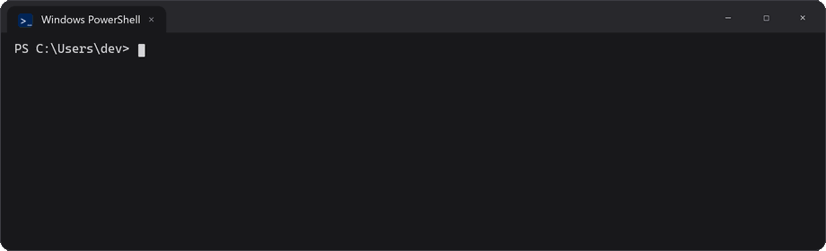
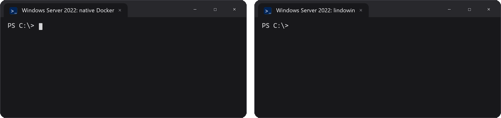

<p align="center">
  <picture>
    <source media="(prefers-color-scheme: dark)" srcset="assets/logo/lindowin-banner-dark.png">
    
  </picture>
</p>

<h3 align="center">El Docker Engine real en Windows, sin Docker Desktop.</h3>

<p align="center">Gratis para cualquier empresa. Solo terminal. <b>9 veces m&aacute;s ligero en Windows</b>, y <b>24&nbsp;MB</b> cuando no hay nada corriendo.</p>

<p align="center">
  <a href="https://github.com/alozdev/lindowin/releases"></a>
  <a href="LICENSE"></a>
  <a href="#requisitos"></a>
  <a href="https://lindowin.dev"></a>
</p>

<br>

```powershell
irm https://lindowin.dev/install | iex
```

Después, `docker run -d -p 8080:80 nginx` funciona tal cual. En Windows 10, 11 y Windows Server, incluso Server Core.



[English](README.md) · [Sitio web](https://lindowin.dev)

---

## Por qué los desarrolladores se cambian

1. 💸 **Gratis para cualquier empresa.** Docker Desktop exige un plan de pago a empresas de más de 250 empleados o más de 10 millones de dólares de ingresos. lindowin es open source (MIT) e instala solo piezas open source: el Docker Engine real y el CLI oficial de `docker`, compose y buildx.
2. 🪶 **9 veces más ligero en Windows.** Sus programas de Windows usan **46 MB** en lugar de ~420 MB, y **0.9%** de CPU en lugar de 7.9%, con los mismos tres contenedores corriendo. Sin contenedores, se duerme y usa **24 MB**.
3. 🔌 **No hay que cambiar nada.** Sirve Docker en el mismo `\\.\pipe\docker_engine` que Docker Desktop: tus archivos compose, VS Code, Testcontainers y los SDK funcionan tal como están.
4. 🌐 **Puertos como en Linux.** Tu compose decide: `80:80` está en tu red, `127.0.0.1:80:80` se queda en tu PC, TCP y UDP, incluso IP específicas.
5. 🖥️ **Windows Server y Server Core.** Imágenes Linux (`nginx`, `postgres`...) donde el Docker nativo de Windows Server solo puede correr imágenes Windows.
6. 🧠 **Se cuida solo.** Arranca con Windows, se duerme cuando no lo usas, mantiene tus contenedores corriendo mientras Docker se actualiza y explica en tu terminal los errores confusos de Docker.

## Los números

Medido en la misma PC, con los mismos tres contenedores (Postgres, Redis, MinIO) corriendo, contra Docker Desktop 4.97:

| | Docker Desktop | **lindowin** | |
|---|---|---|---|
| Programas de Windows (RAM) | ~420 MB | **46 MB** | **9× menos** |
| CPU de Windows | 7.9% | **0.9%** | **9× menos** |
| Dormido / modo ahorro (RAM) | ~380 MB | **24 MB** | **16× menos** |
| Disco, sin tus datos | ~5.6 GB | **~2.3 GB** | **2.4× menos** |
| Arranque en frío | 37 s | **10–19 s** | **hasta 3.5× más rápido** |
| RAM total con 3 contenedores | 2.08 GB | **1.71 GB** | 18% menos |

Dentro de Linux los dos usan la misma memoria: la diferencia es todo lo que Docker Desktop corre en Windows. [Benchmark completo y método](#benchmark).

## Comparación

| | lindowin | Docker Desktop | Docker nativo en Windows Server |
|---|:---:|:---:|:---:|
| Imágenes Linux (`nginx`, `postgres`...) | ✅ | ✅ | ❌ solo imágenes Windows |
| Gratis para empresas | ✅ | ❌ de pago desde 250 personas / 10 M USD | ✅ |
| Windows Server / Server Core | ✅ | ❌ no soportado | ✅ |
| Sin interfaz, arranca sin iniciar sesión | ✅ | ❌ | ✅ |
| CLI oficial de `docker`, compose, buildx | ✅ | ✅ | ✅ |



---

## Instalación

Abre PowerShell (no hace falta ser administrador) y pega:

```powershell
irm https://lindowin.dev/install | iex
```

`docker` funciona en esa misma ventana al terminar. La primera vez tarda unos minutos (descarga Ubuntu y Docker). Windows pide permiso de administrador **una sola vez**.

Otras formas:

- **¿Dominio bloqueado?** `irm https://raw.githubusercontent.com/alozdev/lindowin/main/install.ps1 | iex`
- **Scoop:** `scoop bucket add alozdev https://github.com/alozdev/scoop-bucket` y luego `scoop install lindowin`
- **Doble clic:** [descarga el ZIP](https://github.com/alozdev/lindowin/archive/refs/heads/main.zip), descomprímelo y ejecuta **`install.cmd`**.

<details>
<summary><b>Qué hace el instalador</b></summary>

- **WSL:** lo instala si falta. Si hace falta reiniciar, el instalador **continúa solo** cuando vuelves a iniciar sesión.
- **Motor:** crea una distribución de WSL llamada `docker` (Ubuntu 24.04) e instala Docker Engine con el script oficial, arrancado por systemd. Apaga los servicios que un sistema solo para Docker no usa, así Linux arranca en ~2.6 s.
- **Herramientas de Windows:** `docker.exe`, `docker compose` y `docker buildx` desde sus fuentes oficiales (compose y buildx verificados con sus checksums publicados), más el comando `lindowin`.
- **Puertos:** los puertos publicados funcionan [como en Linux](#puertos-publicados).
- **Arranque:** al iniciar sesión en PCs, al encender en [Windows Server](#windows-server-y-equipos-compartidos).
- **Paso de administrador (una vez):** el grupo `docker-users`, la tarea de arranque y el servicio que abre los puertos publicados. Si dices que no, Docker funciona igual, pero solo desde tu PC y sin arranque automático.
- **Verificación:** al final prueba que todo funcione de punta a punta.

</details>

<details>
<summary><b>¿Ya tienes algo de esto instalado?</b></summary>

Ejecuta el instalador de todos modos. Se puede correr varias veces y solo agrega lo que falta:

| Si ya tienes... | Lo que hace el instalador |
|---|---|
| WSL | Lo usa. Si es anterior a 2.4.4, ejecuta `wsl --update`. |
| Una distribución con el mismo nombre | La reutiliza. Si ya tiene Docker Engine, lo conserva. |
| Tu propio `/etc/wsl.conf` | Lo conserva y solo agrega lo necesario (respaldo: `wsl.conf.before-wsl-docker-engine`). |
| El CLI de Docker / compose / buildx | Los actualiza, y omite los que ya están al día. |
| Docker Desktop | Se detiene y explica por qué: los dos quieren el mismo canal. Desinstálalo antes, o usa `-Force`. |
| Podman / Rancher Desktop en `\\.\pipe\docker_engine` | Te pide detenerlo primero. |
| `DOCKER_HOST`, u otro `docker.exe` antes en el PATH | Te avisa, porque tendrían prioridad. |

</details>

## Requisitos

- Windows 10 2004+ o Windows 11, x64. **Funciona en Windows Home.**
- O Windows Server 2022 / 2025, con o sin escritorio (funciona en Server Core).
- Virtualización activada en la BIOS/UEFI (viene activada en la mayoría de las PCs).

## Uso

Docker se usa exactamente como siempre: `docker run`, `docker compose up`, `docker build`... Para administrar lindowin hay un comando pequeño:

```text
lindowin status          ¿Docker corre? Contenedores, memoria, disco, actualizaciones
lindowin update          Última versión de lindowin y del CLI de Docker (conserva tu configuración)
lindowin stop            Detiene Docker ya y libera su memoria (los contenedores se cierran limpio)
lindowin start           Lo vuelve a arrancar (cualquier comando docker también lo hace)
lindowin compact         Devuelve a Windows el espacio de disco que no se usa
lindowin config          Muestra la configuración de abajo
lindowin uninstall       Desinstala, conservando tus contenedores y datos (--all los borra)
```

**Configuración** (`lindowin config <ajuste> <valor>`), que se conserva al actualizar:

| Ajuste | Valores | Por defecto |
|---|---|---|
| `idle-sleep` | `on` / `off`: apaga la máquina virtual de Linux tras 5 min sin contenedores | `on` en PCs, `off` en servidores |
| `start-at` | `signin` / `boot`: arrancar al iniciar sesión, o al encender sin que nadie inicie sesión | `signin` en PCs, `boot` en servidores |
| `share` | `me` / `all-users`: solo tú, o todos los del grupo `docker-users` | `me` |
| `network` | `mirrored` / `nat` / `local`: cómo llegan a la red los puertos publicados | `mirrored` si funciona en tu PC |

Los cambios se aplican al momento, y las terminales que ya están abiertas siguen funcionando.

## Modo reposo

Si no hay contenedores corriendo durante 5 minutos, lindowin deja que WSL apague la máquina virtual de Linux: Docker pasa a usar **24 MB** en vez de ~1.5 GB. El siguiente comando `docker` lo vuelve a arrancar, y Windows muestra un aviso breve *"Starting Docker..."* para que la espera (unos 20 s, [por qué](#benchmark)) no sea un misterio. Nunca se duerme mientras corre un contenedor o un comando. Se apaga con `lindowin config idle-sleep off`.

## Puertos publicados

Los puertos siguen exactamente lo que dice tu `docker-compose.yml` o `docker run -p`, como en un servidor Linux:

| Escribes | Se alcanza desde |
|---|---|
| `80:80` | Tu PC **y tu red** (TCP) |
| `127.0.0.1:80:80` | **Solo tu PC** |
| `192.168.1.20:80:80` | Solo esa IP de red |
| `53:53/udp` | Tu PC y tu red (UDP) |

El firewall de Windows abre un puerto cuando su contenedor arranca y lo cierra cuando se detiene: solo los puertos que publicaste.

> **Consejo:** las bases de datos y paneles de administración normalmente no necesitan estar en tu red. Publícalos como `127.0.0.1:5432:5432`.

**Modos de red.** Por defecto lindowin usa el *modo de red mirrored* de WSL (Windows 11 22H2+ / Server 2025), que se comporta exactamente como Linux. Si mirrored deja sin internet a WSL en tu PC (pasa con algunas VPN), el instalador cambia solo a *NAT con reenvío de puertos*. También puedes elegirlo con `lindowin config network nat`:

| | Mirrored (por defecto) | NAT (alternativa) |
|---|---|---|
| `80:80`, `127.0.0.1:80:80`, UDP | ✅ | ✅ |
| IP específica (`192.168.1.20:80:80`) | ✅ | ❌ el contenedor no arranca: la nota de lindowin en el error lo explica |
| Despierta del reposo en | ~22 s | ~11 s |
| Funciona con cualquier VPN | Normalmente | ✅ |

Tu `.wslconfig` original se respalda y se restaura al desinstalar.

## Windows Server y equipos compartidos

Mismo instalador, mismos comandos. En **Windows Server** detecta la edición y Docker **arranca al encender, sin que nadie inicie sesión**, como el servicio de Docker en Linux. Los contenedores con `restart: always` / `unless-stopped` vuelven después de reiniciar.

- Funciona en **Server Core**: todo se hace desde PowerShell.
- **Máquinas virtuales:** activa la virtualización anidada en el host (Hyper-V: `Set-VMProcessor -VMName <vm> -ExposeVirtualizationExtensions $true`).
- **Server 2022** no tiene modo mirrored, así que usa NAT. Server 2025 usa mirrored.

**Compartir Docker con todos los usuarios** de un servidor, laboratorio o PC familiar: `lindowin config share all-users` (o instala con `-AllUsers`). Los programas van a Program Files y al PATH del equipo, Docker arranca al encender, y todos los del grupo `docker-users` pueden usarlo, como el grupo `docker` en Linux:

```powershell
Add-LocalGroupMember docker-users <usuario>     # como administrador
```

## Actualizaciones

- **Docker Engine se actualiza solo** dentro de Linux, junto con las actualizaciones de seguridad de Ubuntu. Con `live-restore`, **tus contenedores siguen corriendo** mientras se actualiza.
- **lindowin y el CLI de Docker** para Windows: una vez al día lindowin revisa si hay versiones nuevas y te avisa (una notificación en PCs, una línea en los comandos `lindowin`). No instala nada sin ti: ejecuta `lindowin update` y se conserva tu configuración.

## Cuando Docker dice algo confuso

Algunos errores de Docker no tienen sentido en Windows. lindowin les agrega una línea, en tu terminal, con la solución:

```text
Error response from daemon: ... failed to bind host port 0.0.0.0:5432/tcp: address already in use
lindowin: port 5432 is already used on Windows by postgres.exe (PID 4120). Stop that program, or publish a different host port.
```

| Situación | Lo que te dice lindowin |
|---|---|
| Un programa de Windows ya usa el puerto | Qué programa y su PID |
| Un puerto en una IP específica sin red mirrored | Cómo cambiar a mirrored |
| Una ruta de Windows en `docker run -v C:\...` | La forma `/c/Users/...` que debes usar |
| Docker perdió la configuración de una red | `docker compose up -d --force-recreate` (los datos se conservan) |
| WSL arrancó sin red (VPN) | Reinicia WSL una vez por su cuenta; si no basta, una notificación |
| Docker Desktop o Podman tomaron el canal de Docker | Qué programa, en una notificación y en `lindowin status` |
| Menos de 2 GB libres, o más de 5 GB recuperables | Una notificación, y `lindowin compact` |

## Cómo funciona

```
 Windows                                         Distribución WSL 2 "docker" (Ubuntu)
 ───────                                         ────────────────────────────────────
 docker.exe / compose / buildx / VS Code ...
        │
        ▼
 \\.\pipe\docker_engine  ◄── docker-pipe-relay.exe ── wsl.exe ── socat ──► /var/run/docker.sock
   (el mismo canal que Docker Desktop)                                        │
                                                                       Docker Engine (systemd)
```

Docker Desktop hace lo mismo por dentro: una máquina Linux en WSL corre `dockerd`, y un proceso de Windows conecta el canal con ella. lindowin reemplaza esa app gráfica con piezas pequeñas y legibles:

- **`src/wsl/setup.sh`**: configura la distribución: systemd, Docker Engine, actualizaciones automáticas, un sistema más ligero y arranque más rápido.
- **`src/relay/docker-pipe-relay.cs`**: el relay, con el modo reposo y las notas en los errores. Se compila en tu PC con el compilador de C# que ya trae Windows: no se descargan binarios precompilados de este repo.
- **`src/ports/docker-port-sync.cs`**: abre y cierra el firewall para los puertos publicados. También se compila en tu PC.
- **`src/lindowin.ps1`**: el comando `lindowin`.
- **`install.ps1` / `uninstall.ps1`**: la parte de Windows.

## Desinstalación

```text
lindowin uninstall           Quita lindowin y conserva el motor con todos tus contenedores, imágenes y volúmenes
lindowin uninstall --all     Quita todo, incluidos todos los datos de Docker (pide confirmación)
```

Quita `docker.exe`, los plugins de compose y buildx que instaló, el relay, la tarea de arranque, el servicio de puertos con todas las reglas de firewall que creó, el grupo `docker-users` (solo si lo creó él), los cambios al PATH y la preferencia de `::1`, y restaura tu `.wslconfig` original. Los plugins que instalaste tú no se tocan.

**Antes de `--all`:** detén tus apps (`docker compose down`) para que las bases de datos se cierren bien, y respalda los volúmenes con nombre si los necesitas, por ejemplo `docker run --rm -v mivol:/v -v /c/respaldo:/b alpine tar czf /b/mivol.tgz -C /v .`. Las carpetas de Windows (bind mounts como `./data`) nunca se tocan.

## Bueno saber

- **Los bind mounts de compose funcionan** (`./data:/data`): compose convierte `C:\...` en `/c/...`, y `/c` es tu disco C dentro de Linux. Con `docker run -v`, escribe `/c/Users/tu-usuario/proyecto:/app`.
- **Rendimiento:** los volúmenes con nombre viven dentro de Linux y son rápidos. Montar carpetas de Windows funciona, pero es más lento, igual que en Docker Desktop. Para bases de datos, mejor volúmenes con nombre.
- **Los permisos en discos de Windows** funcionan (opción `metadata` de WSL), así imágenes como Postgres corren sobre carpetas de Windows montadas.
- **`localhost` es `127.0.0.1`.** WSL no puede pasar el loopback IPv6 (`::1`) a los contenedores: Linux lo descarta y las apps se quedan esperando. Por eso lindowin baja solo la prioridad de `::1` en la tabla de preferencia de direcciones de Windows (si nunca la cambiaste): `localhost` prueba primero `127.0.0.1` y el resto de IPv6 funciona igual que antes. Al desinstalar se restaura.
- **Desinstalar Docker Desktop borra tus plugins compose y buildx** (comparten carpeta). Ejecuta `lindowin update` para reponerlos.

## Seguridad

- **Quién puede usar Docker:** solo tu usuario de Windows y los miembros del grupo local `docker-users`, como en Docker Desktop. Se rechazan las conexiones desde la red.
- **Sin puerto TCP:** Docker nunca queda expuesto en `tcp://...:2375`.
- **Solo se abren los puertos que publicas,** y se cierran cuando el contenedor se detiene. Los puertos en `127.0.0.1` nunca se abren.
- **El servicio de puertos corre como SYSTEM** (cambia el firewall), se compila en Program Files, donde un usuario normal no puede reemplazarlo, y solo lee de Docker.
- **Sin impostores:** si otro programa tiene `\\.\pipe\docker_engine`, el relay se niega a arrancar.
- **Descargas verificadas** desde fuentes oficiales, y actualizaciones de seguridad automáticas para Ubuntu y Docker Engine.
- **Nada se instala solo:** las actualizaciones se anuncian, nunca se aplican sin ti.

Quien puede usar `docker` tiene, en la práctica, acceso root dentro de la distribución de WSL, igual que con Docker Desktop.

## Solución de problemas

Empieza con **`lindowin status`**: muestra qué está mal y el comando para arreglarlo.

| Problema | Solución |
|---|---|
| `docker` no se reconoce | Abre una terminal nueva (el PATH cambió), o instala desde PowerShell con `irm ... \| iex`. |
| `failed to connect to the docker API at npipe:////./pipe/docker_engine` | `lindowin start`. Si `lindowin status` nombra otro programa (Docker Desktop, Podman), ciérralo primero. |
| La instalación falla con `0x80370102` | Activa la virtualización (Intel VT-x / AMD-V) en la BIOS/UEFI. |
| WSL se quedó sin internet, o los contenedores no tienen red | `lindowin config network nat` (algunas VPN no funcionan con mirrored). |
| Un puerto publicado no se alcanza desde la red | `C:\ProgramData\wsl-docker-engine\port-sync.log`. Si no aceptaste el permiso de administrador, ejecuta el instalador otra vez. |
| Faltan `docker compose` o `docker buildx` | `lindowin update` (el desinstalador de Docker Desktop los borra). |
| Smart App Control bloquea `docker-pipe-relay.exe` | Se compila en tu PC y aún no tiene firma, así que Windows puede bloquear el primer arranque de una compilación nueva. lindowin lo reintenta solo y Windows normalmente lo permite la segunda vez; si no, ejecuta `lindowin start`. Está planeado firmarlo. |
| Una app se queda esperando al conectar a `localhost` (con `127.0.0.1` sí funciona) | Ejecuta el instalador de nuevo: hace que `localhost` pruebe primero `127.0.0.1`. Compruébalo con `ping localhost` (debe responder desde `127.0.0.1`). |
| Docker no arranca dentro de Linux | `wsl -d docker -u root -- systemctl status docker` |

Registros: `%LOCALAPPDATA%\Programs\wsl-docker-engine\bin\docker-pipe-relay.log`.

## Benchmark

Todo medido en una PC (Windows 11, 12 núcleos, 8 GB para WSL), lindowin 1.2.0 contra Docker Desktop 4.97, ambos con la red mirrored de WSL salvo donde se indica. "Programas de Windows" es la memoria privada de los procesos de cada herramienta; la máquina virtual de Linux se mide aparte.

| | Docker Desktop | lindowin |
|---|---|---|
| Programas de Windows, 3 contenedores (RAM) | ~420 MB | **46 MB** |
| CPU de Windows, 3 contenedores | 7.9% | **0.9%** |
| Memoria usada dentro de Linux, 3 contenedores | 804 MB | 815 MB |
| RAM total (Administrador de tareas), 3 contenedores | 2.08 GB | **1.71 GB** |
| Dormido / modo ahorro (RAM) | ~380 MB | **24 MB** |
| Dormido (CPU) | 3.2% | **0.6%** |
| Disco sin tus datos | ~5.6 GB | **~2.3 GB** |
| Arranque en frío, WSL apagado (NAT) | 37 s | **~10.5 s** |
| Arranque en frío, WSL apagado (mirrored) | n/d | ~19 s |
| Despertar del reposo (NAT) | **7 s** | ~11 s |
| Despertar del reposo (mirrored) | **12.5 s** | 22 s |
| `docker run --rm alpine true`, ya despierto | **0.5 s** | 1.3–1.5 s |

**Dónde Docker Desktop es más rápido, y por qué:**

- **Al despertar.** lindowin usa un Ubuntu normal con systemd, que da actualizaciones de seguridad automáticas y reinicios limpios de Docker, pero suma ~2.6 s a cada arranque; el Linux mínimo propio de Docker Desktop se lo ahorra. La red mirrored suma ~8 s más a cualquier arranque de WSL (también a Docker Desktop). Con `lindowin config network nat`, lindowin despierta en ~11 s.
- **En cada comando `docker`.** El `docker.exe` oficial que Docker publica para descargar no tiene firma digital (el que viene dentro de Docker Desktop sí), así que Windows Defender lo revisa cada vez que se ejecuta: unos 0.5 s. El relay de lindowin agrega solo 30–90 ms por petición.

## Preguntas frecuentes

**¿Por qué no usar Docker Desktop?**
Es buen software, pero exige un plan de pago a empresas grandes, mantiene una interfaz y servicios en segundo plano todo el tiempo y no corre en Windows Server. lindowin te da la misma experiencia de Docker desde la terminal, solo con piezas open source.

**¿Por qué no Podman?**
Podman también es una buena opción. lindowin es para quien quiere el Docker Engine real (100% comportamiento de Docker, BuildKit, compose) con el CLI oficial.

**¿Por qué no usar `DOCKER_HOST=tcp://localhost:2375`?**
Eso abre un puerto sin autenticación con acceso root, y el reenvío de localhost de WSL corta los flujos que `docker run` usa para mostrar la salida. El canal con nombre evita los dos problemas.

## Contribuir

Los issues y pull requests son bienvenidos: reportes de bugs, pruebas en otras versiones de Windows, ideas. Lee [CONTRIBUTING.md](CONTRIBUTING.md) (en inglés) y el [historial de cambios](CHANGELOG.md). Si lindowin te sirve, una ⭐ ayuda a que más gente lo encuentre.

[](https://github.com/alozdev/lindowin/graphs/contributors)

## Licencias

lindowin está bajo la [licencia MIT](LICENSE). El instalador **descarga** estos componentes de sus fuentes oficiales; no los redistribuye:

| Componente | Licencia | Origen |
|---|---|---|
| Docker Engine (Moby) | Apache-2.0 | `download.docker.com` (apt) |
| Docker CLI | Apache-2.0 | `download.docker.com` |
| Docker Compose | Apache-2.0 | `github.com/docker/compose` |
| Docker Buildx | Apache-2.0 | `github.com/docker/buildx` |
| socat | GPL-2.0 | Repositorio de Ubuntu |
| Ubuntu | Varias licencias open source | Microsoft Store / Canonical |

*Docker y el logo de Docker son marcas registradas de Docker, Inc. Este proyecto no está afiliado, respaldado ni patrocinado por Docker, Inc. No usa ni modifica Docker Desktop.*
