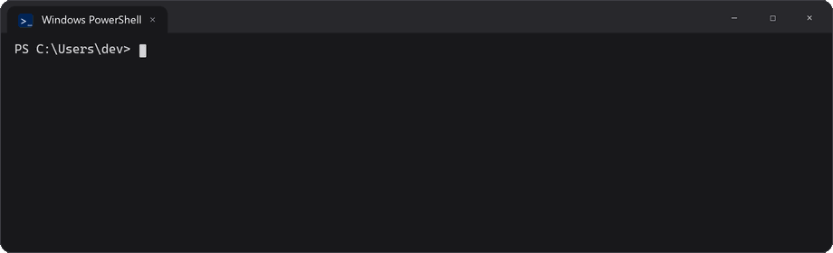
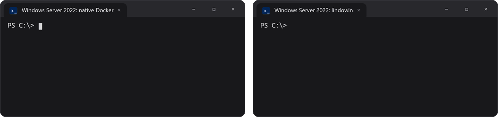

<p align="center">
  <picture>
    <source media="(prefers-color-scheme: dark)" srcset="assets/logo/lindowin-banner-dark.png">
    
  </picture>
</p>

<h3 align="center">The real Docker Engine on Windows, without Docker Desktop.</h3>

<p align="center">Free for any company. Terminal only. <b>9&times; lighter on Windows</b>, and <b>24&nbsp;MB</b> when nothing is running.</p>

<p align="center">
  <a href="https://github.com/alozdev/lindowin/releases"></a>
  <a href="LICENSE"></a>
  <a href="#requirements"></a>
  <a href="https://lindowin.dev"></a>
</p>

<br>

```powershell
irm https://lindowin.dev/install | iex
```

Then `docker run -d -p 8080:80 nginx` just works. On Windows 10, 11 and Windows Server, even Server Core.



[Español](README.es.md) · [Website](https://lindowin.dev)

---

## Why developers switch

1. 💸 **Free for any company.** Docker Desktop needs a paid plan above 250 employees or $10M in revenue. lindowin is open source (MIT) and installs only open-source pieces: the real Docker Engine and the official `docker` CLI, compose and buildx.
2. 🪶 **9× lighter on Windows.** Its Windows programs use **46 MB** instead of ~420 MB, and **0.9%** CPU instead of 7.9%, with the same three containers running. With no containers, it sleeps at **24 MB**.
3. 🔌 **Nothing to change.** It serves Docker on the same `\\.\pipe\docker_engine` as Docker Desktop: your compose files, VS Code, Testcontainers and SDKs work as they are.
4. 🌐 **Ports like on Linux.** Your compose file decides: `80:80` is on your network, `127.0.0.1:80:80` stays on your PC, TCP and UDP, even specific IPs.
5. 🖥️ **Windows Server and Server Core.** Linux images (`nginx`, `postgres`...) where the native Docker for Windows Server can only run Windows images.
6. 🧠 **Takes care of itself.** Starts with Windows, sleeps when idle, keeps containers running while Docker updates itself, and explains confusing Docker errors right in your terminal.

## The numbers

Measured on the same PC with the same three containers (Postgres, Redis, MinIO) running, against Docker Desktop 4.97:

| | Docker Desktop | **lindowin** | |
|---|---|---|---|
| Windows programs (RAM) | ~420 MB | **46 MB** | **9× less** |
| Windows CPU | 7.9% | **0.9%** | **9× less** |
| Asleep / resource saver (RAM) | ~380 MB | **24 MB** | **16× less** |
| Disk, without your data | ~5.6 GB | **~2.3 GB** | **2.4× less** |
| Cold start | 37 s | **10–19 s** | **up to 3.5× faster** |
| Total RAM with 3 containers | 2.08 GB | **1.71 GB** | 18% less |

Inside Linux both use the same memory: the difference is everything Docker Desktop runs on Windows. [Full benchmark and method](#benchmark).

## How it compares

| | lindowin | Docker Desktop | Native Docker on Windows Server |
|---|:---:|:---:|:---:|
| Linux images (`nginx`, `postgres`...) | ✅ | ✅ | ❌ Windows images only |
| Free for companies | ✅ | ❌ paid above 250 people / $10M | ✅ |
| Windows Server / Server Core | ✅ | ❌ not supported | ✅ |
| No GUI, starts without signing in | ✅ | ❌ | ✅ |
| Official `docker` CLI, compose, buildx | ✅ | ✅ | ✅ |



---

## Install

Open PowerShell (no admin needed) and paste:

```powershell
irm https://lindowin.dev/install | iex
```

`docker` works in that same window when it finishes. The first install takes a few minutes (it downloads Ubuntu and Docker). Windows asks for administrator permission **once**.

Other ways:

- **Blocked domain?** `irm https://raw.githubusercontent.com/alozdev/lindowin/main/install.ps1 | iex`
- **Double-click:** [download the ZIP](https://github.com/alozdev/lindowin/archive/refs/heads/main.zip), extract it and run **`install.cmd`**.

<details>
<summary><b>What the installer does</b></summary>

- **WSL:** installs it if missing. If a restart is needed, the installer **continues by itself** after you sign in again.
- **Engine:** creates a WSL distro called `docker` (Ubuntu 24.04) and installs Docker Engine with the official script, started by systemd. Services a Docker-only system never uses are turned off, so Linux starts in ~2.6 s.
- **Windows tools:** `docker.exe`, `docker compose` and `docker buildx` from their official sources (compose and buildx checked against their published checksums), plus the `lindowin` command.
- **Ports:** published ports work [like on Linux](#published-ports).
- **Start:** at sign-in on PCs, at boot on [Windows Server](#windows-server-and-shared-machines).
- **Admin step (once):** the `docker-users` group, the start task and the service that opens published ports. Say no and Docker still works, only from your PC and without autostart.
- **Check:** it tests the whole chain at the end.

</details>

<details>
<summary><b>Already have some of this installed?</b></summary>

Run the installer anyway. It is safe to run more than once and only adds what is missing:

| You already have... | What the installer does |
|---|---|
| WSL | Uses it. If it is older than 2.4.4, it runs `wsl --update`. |
| A distro with the same name | Reuses it. If Docker Engine is already installed there, it is kept. |
| Your own `/etc/wsl.conf` | Keeps it and only adds the needed keys (backup: `wsl.conf.before-wsl-docker-engine`). |
| The Docker CLI / compose / buildx | Updates them, skipping any that are already up to date. |
| Docker Desktop | Stops and explains why: both want the same pipe. Uninstall it first, or use `-Force`. |
| Podman / Rancher Desktop on `\\.\pipe\docker_engine` | Asks you to stop it first. |
| `DOCKER_HOST`, or another `docker.exe` earlier in PATH | Warns you, because those would take priority. |

</details>

## Requirements

- Windows 10 2004+ or Windows 11, x64. **Windows Home works.**
- Or Windows Server 2022 / 2025, with or without desktop (Server Core works).
- Virtualization enabled in BIOS/UEFI (on by default on most PCs).

## Use it

Docker is used exactly as always: `docker run`, `docker compose up`, `docker build`... To manage lindowin itself there is one small command:

```text
lindowin status          Is Docker running? Containers, memory, disk, updates
lindowin update          Latest lindowin and Docker CLI (keeps your settings)
lindowin stop            Stop Docker now and free its memory (containers shut down cleanly)
lindowin start           Start it again (any docker command does that too)
lindowin compact         Give unused disk space back to Windows
lindowin config          Show the settings below
lindowin uninstall       Uninstall, keeping your containers and data (--all deletes them)
```

**Settings** (`lindowin config <setting> <value>`), remembered on updates:

| Setting | Values | Default |
|---|---|---|
| `idle-sleep` | `on` / `off`: stop the Linux VM after 5 min with no containers | `on` on PCs, `off` on servers |
| `start-at` | `signin` / `boot`: start when you sign in, or at boot with nobody signed in | `signin` on PCs, `boot` on servers |
| `share` | `me` / `all-users`: just you, or everyone in the `docker-users` group | `me` |
| `network` | `mirrored` / `nat` / `local`: how published ports reach the network | `mirrored` if it works on your PC |

Changes apply right away, and terminals that are already open keep working.

## Idle sleep

With no containers running for 5 minutes, lindowin lets WSL stop the Linux VM: Docker then uses **24 MB** instead of ~1.5 GB. The next `docker` command starts it again, and Windows shows a short *"Starting Docker..."* notification so the wait (about 20 s, [why](#benchmark)) is not a mystery. It never sleeps while a container runs or a command is in progress. Turn it off with `lindowin config idle-sleep off`.

## Published ports

Ports follow your `docker-compose.yml` / `docker run -p` exactly, as on a Linux server:

| You write | Reachable from |
|---|---|
| `80:80` | Your PC **and your network** (TCP) |
| `127.0.0.1:80:80` | **Only your PC** |
| `192.168.1.20:80:80` | That network IP only |
| `53:53/udp` | Your PC and your network (UDP) |

The Windows firewall opens a port when its container starts and closes it when it stops: only the ports you published.

> **Tip:** databases and admin panels usually don't need to be on your network. Publish them as `127.0.0.1:5432:5432`.

**Network modes.** By default lindowin uses WSL's *mirrored networking* (Windows 11 22H2+ / Server 2025), which behaves exactly like Linux. If mirrored breaks WSL's internet on your PC (it happens with some VPNs), the installer switches to *NAT with port forwarding* by itself. You can also choose with `lindowin config network nat`:

| | Mirrored (default) | NAT (fallback) |
|---|---|---|
| `80:80`, `127.0.0.1:80:80`, UDP | ✅ | ✅ |
| Specific IP (`192.168.1.20:80:80`) | ✅ | ❌ the container does not start: lindowin's note in the error explains it |
| Wakes from idle sleep in | ~22 s | ~11 s |
| Works with every VPN | Usually | ✅ |

Your original `.wslconfig` is backed up and restored when you uninstall.

## Windows Server and shared machines

Same installer, same commands. On **Windows Server** it detects the edition and Docker **starts at boot, without anyone signing in**, like the Docker service on Linux. Containers with `restart: always` / `unless-stopped` come back after a reboot.

- Works on **Server Core**: everything runs from PowerShell.
- **Virtual machines:** enable nested virtualization on the host (Hyper-V: `Set-VMProcessor -VMName <vm> -ExposeVirtualizationExtensions $true`).
- **Server 2022** has no mirrored networking, so it uses NAT. Server 2025 uses mirrored.

**Share Docker with every user** of a server, lab or family PC: `lindowin config share all-users` (or install with `-AllUsers`). The programs go to Program Files and the machine PATH, Docker starts at boot, and everyone in the `docker-users` group can use it, like the `docker` group on Linux:

```powershell
Add-LocalGroupMember docker-users <user>     # as administrator
```

## Updates

- **Docker Engine updates itself** inside Linux, with Ubuntu's security updates. With `live-restore`, **running containers keep running** while it does.
- **lindowin and the Docker CLI** for Windows: once a day lindowin checks for new versions and tells you (a notification on PCs, a line in `lindowin` commands). Nothing is installed without you: run `lindowin update`, and your settings are kept.

## When Docker says something confusing

Some Docker errors make no sense on Windows. lindowin adds one line to them, in your terminal, with the fix:

```text
Error response from daemon: ... failed to bind host port 0.0.0.0:5432/tcp: address already in use
lindowin: port 5432 is already used on Windows by postgres.exe (PID 4120). Stop that program, or publish a different host port.
```

| Situation | What lindowin tells you |
|---|---|
| A Windows program already uses the port | Which program and its PID |
| A port on a specific IP without mirrored networking | How to switch to mirrored |
| A Windows path in `docker run -v C:\...` | The `/c/Users/...` form to use |
| Docker lost a network's setup | `docker compose up -d --force-recreate` (data is kept) |
| WSL started without network (VPNs) | It restarts WSL once by itself; if that fails, a notification |
| Docker Desktop or Podman took the Docker pipe | Which program, in a notification and in `lindowin status` |
| Less than 2 GB free, or 5+ GB to give back | A notification, and `lindowin compact` |

## How it works

```
 Windows                                         WSL 2 distro "docker" (Ubuntu)
 ───────                                         ──────────────────────────────
 docker.exe / compose / buildx / VS Code ...
        │
        ▼
 \\.\pipe\docker_engine  ◄── docker-pipe-relay.exe ── wsl.exe ── socat ──► /var/run/docker.sock
   (same pipe as Docker Desktop)                                              │
                                                                       Docker Engine (systemd)
```

Docker Desktop does the same thing internally: a Linux VM in WSL runs `dockerd`, and a Windows process connects the pipe to it. lindowin replaces that GUI app with small, readable pieces:

- **`src/wsl/setup.sh`**: configures the distro: systemd, Docker Engine, automatic updates, a lighter system and faster start.
- **`src/relay/docker-pipe-relay.cs`**: the relay, with idle sleep and the error notes. Compiled on your PC by the C# compiler that ships with Windows: no prebuilt binaries are downloaded from this repo.
- **`src/ports/docker-port-sync.cs`**: opens and closes the firewall for published ports. Also compiled on your PC.
- **`src/lindowin.ps1`**: the `lindowin` command.
- **`install.ps1` / `uninstall.ps1`**: the Windows side.

## Uninstall

```text
lindowin uninstall           Remove lindowin, keep the engine with all containers, images and volumes
lindowin uninstall --all     Remove everything, including all Docker data (asks you to confirm)
```

It removes `docker.exe`, the compose/buildx plugins it installed, the relay, the start task, the port service and every firewall rule it created, the `docker-users` group (only if it created it), the PATH changes, and restores your original `.wslconfig`. Plugins you installed yourself are left alone.

**Before `--all`:** stop your apps (`docker compose down`) so databases shut down cleanly, and back up named volumes if you need them, for example `docker run --rm -v myvol:/v -v /c/backup:/b alpine tar czf /b/myvol.tgz -C /v .`. Folders from Windows (bind mounts like `./data`) are never touched.

## Good to know

- **Compose bind mounts work** (`./data:/data`): compose turns `C:\...` into `/c/...`, and `/c` is your C: drive inside Linux. With plain `docker run -v`, write `/c/Users/you/project:/app`.
- **Performance:** named volumes live inside Linux and are fast. Bind mounts of Windows folders work but are slower, as with Docker Desktop. Prefer named volumes for databases.
- **File permissions on Windows drives** work (WSL's `metadata` option), so images like Postgres run on bind-mounted Windows folders.
- **Uninstalling Docker Desktop deletes your compose and buildx plugins** (they share a folder). Run `lindowin update` to put them back.

## Security

- **Who can use Docker:** only your Windows user and members of the local `docker-users` group, like Docker Desktop. Network clients are rejected.
- **No TCP port:** Docker is never exposed on `tcp://...:2375`.
- **Ports are opened only for what you publish,** and closed when the container stops. `127.0.0.1` ports are never opened.
- **The port service runs as SYSTEM** (it changes the firewall), is compiled into Program Files where normal users cannot replace it, and only reads from Docker.
- **No impostors:** if another program owns `\\.\pipe\docker_engine`, the relay refuses to start.
- **Verified downloads** from official sources, and automatic security updates for Ubuntu and Docker Engine.
- **Nothing installs itself:** updates are announced, never applied without you.

Anyone who can run `docker` effectively has root inside the WSL distro, as with Docker Desktop.

## Troubleshooting

Start with **`lindowin status`**: it shows what is wrong and the command to fix it.

| Problem | Fix |
|---|---|
| `docker` not found | Open a new terminal (PATH changed), or run the installer from PowerShell with `irm ... \| iex`. |
| `failed to connect to the docker API at npipe:////./pipe/docker_engine` | `lindowin start`. If `lindowin status` names another program (Docker Desktop, Podman), quit it first. |
| Install fails with `0x80370102` | Enable virtualization (Intel VT-x / AMD-V) in BIOS/UEFI. |
| WSL lost internet, or containers have no network | `lindowin config network nat` (some VPNs break mirrored networking). |
| A published port is not reachable from the network | `C:\ProgramData\wsl-docker-engine\port-sync.log`. If you skipped the admin prompt, run the installer again. |
| `docker compose` or `docker buildx` missing | `lindowin update` (Docker Desktop's uninstaller removes them). |
| Smart App Control blocks `docker-pipe-relay.exe` | It is compiled on your PC and not signed. Not seen so far; if it happens, please [open an issue](https://github.com/alozdev/lindowin/issues). |
| Docker inside Linux does not start | `wsl -d docker -u root -- systemctl status docker` |

Logs: `%LOCALAPPDATA%\Programs\wsl-docker-engine\bin\docker-pipe-relay.log`.

## Benchmark

All numbers measured on one PC (Windows 11, 12 cores, 8 GB for WSL), lindowin 1.2.0 vs Docker Desktop 4.97, both with WSL mirrored networking unless noted. "Windows programs" is the private memory of each tool's own processes; the Linux VM is measured separately.

| | Docker Desktop | lindowin |
|---|---|---|
| Windows programs, 3 containers (RAM) | ~420 MB | **46 MB** |
| Windows CPU, 3 containers | 7.9% | **0.9%** |
| Memory used inside Linux, 3 containers | 804 MB | 815 MB |
| Total RAM (Task Manager), 3 containers | 2.08 GB | **1.71 GB** |
| Asleep / resource saver (RAM) | ~380 MB | **24 MB** |
| Asleep (CPU) | 3.2% | **0.6%** |
| Disk without your data | ~5.6 GB | **~2.3 GB** |
| Cold start, WSL off (NAT) | 37 s | **~10.5 s** |
| Cold start, WSL off (mirrored) | n/a | ~19 s |
| Wake from sleep (NAT) | **7 s** | ~11 s |
| Wake from sleep (mirrored) | **12.5 s** | 22 s |
| `docker run --rm alpine true`, awake | **0.5 s** | 1.3–1.5 s |

**Where Docker Desktop is faster, and why:**

- **Waking up.** lindowin runs a regular Ubuntu with systemd, which gives automatic security updates and clean Docker restarts but adds ~2.6 s to every start; Docker Desktop's own minimal Linux skips that. Mirrored networking adds ~8 s more to any WSL start (for Docker Desktop too). With `lindowin config network nat`, lindowin wakes in ~11 s.
- **Each `docker` command.** The official `docker.exe` that Docker publishes for download is not digitally signed (the one inside Docker Desktop is), so Windows Defender inspects it every time it runs: about 0.5 s. The lindowin relay itself adds only 30–90 ms per request.

## FAQ

**Why not just use Docker Desktop?**
It is good software, but it needs a paid plan for larger companies, runs a GUI and background services all the time, and does not run on Windows Server. lindowin gives you the same Docker experience from the terminal, with only open-source pieces.

**Why not Podman?**
Podman is a good option too. lindowin is for people who want the real Docker Engine (100% Docker behavior, BuildKit, compose) with the official CLI.

**Why not set `DOCKER_HOST=tcp://localhost:2375`?**
That opens an unauthenticated root-level port, and WSL's localhost forwarding breaks the streams `docker run` uses to show output. The named pipe avoids both problems.

## Contributing

Issues and pull requests are welcome: bug reports, tests on other Windows versions, ideas. See [CONTRIBUTING.md](CONTRIBUTING.md) and the [changelog](CHANGELOG.md). If lindowin is useful to you, a ⭐ helps others find it.

[](https://github.com/alozdev/lindowin/graphs/contributors)

## Licenses

lindowin is under the [MIT License](LICENSE). The installer **downloads** these components from their official sources; it does not redistribute them:

| Component | License | Source |
|---|---|---|
| Docker Engine (Moby) | Apache-2.0 | `download.docker.com` (apt) |
| Docker CLI | Apache-2.0 | `download.docker.com` |
| Docker Compose | Apache-2.0 | `github.com/docker/compose` |
| Docker Buildx | Apache-2.0 | `github.com/docker/buildx` |
| socat | GPL-2.0 | Ubuntu archive |
| Ubuntu | Various open-source licenses | Microsoft Store / Canonical |

*Docker and the Docker logo are trademarks of Docker, Inc. This project is not affiliated with, endorsed by or sponsored by Docker, Inc. It does not use or modify Docker Desktop.*
